# 前言

我所阅读的书是《Types and Programming Languages》。这是关于第九章的学习笔记。 

# Function Types

上一章介绍了简单的静态类型系统，以算术系统和Bool以及Nat类型作为例子。同时也讲述了什么是`ill-typed`，分为两种情况，一种是在类型计算期间进入了卡死状态（例如： `if 0 then 1 else 2`，if后面需要的是Bool而不是Nat），另一种就是在运行期能正常运行，但是因为系统过于保守导致无法通过静态类型检查的（例如： `if true then 0 else false`）。

这一章将会只用Bool给lambda拓展出对应的类型系统。

首先我们需要给一个函数赋予类型，也就是说我们需要知道他返回的是什么类型，他的参数是什么类型，为了做到这点，这里开始运用无数的$T_1 → T_2$，$T_1$代表着接受的参数类型，而$T_2$代表着返回的类型。

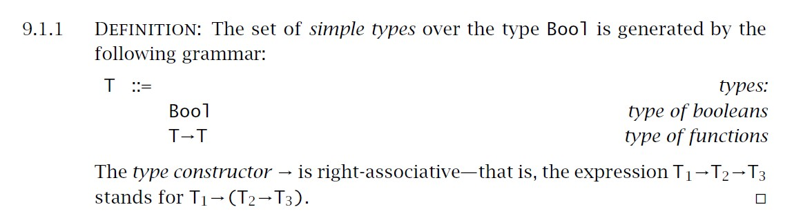

根据规则9.1.1来举个例子，以下都是合法的：
```text
Bool → Bool

(Bool → Bool) → (Bool → Bool)
上面这条和下面这条是等价的
(Bool → Bool) → Bool → Bool
```

# The Function Relation

为了给函数赋予类型，通常有两种方法，第一张是手动给函数的参数写上类型，另一种就是需要自行去计算得出类型。

手动赋予的被称为`explicitly typed`。

让类型检查器去推断信息的被称为`implicitly typed`。同时这也是lambda演算法所使用的系统。

一旦知道了函数的参数类型，同时还知道参数如何被运用的时候，我们就可以知道函数的返回类型。

```text
   x:T₁ ⊦ t₂: T₂
---------------------    (T-ABS)
⊦ λx:T₁.t₂ : T₁ → T₂
```

上面这条式子也就表达了这意思，解释一下就是存在参数x的类型为T₁，通过它能得出项t₂的类型，也就是x如何被运用在里面，最后就能得出整个lambda函数的类型。

如果仔细思考一下，项t₂可能会包含了很多非x的项，这时候，也就是单纯的`x`是不会让`x:T₁ ⊦ t₂: T₂`成立的。于是乎就需要`Γ ⊦ t:T`，`Γ`是一个包含着所有在项t的free variables的假设的集合（Γ is a set of assumptions about the types of the free variables in t）。如果`Γ`不存在任何东西，也就是`∅`，这时候就会写作`⊦ t:T`，也就意味着 The closed term t has type T under the empty set of assumptions.

对了，`Γ`被称作type environment，同时也就是我们平时说的上下文，它由一串带有类型的变量组成的。

于是乎，我们的证明式就变成了：
```text
   Γ, x:T₁ ⊦ t₂: T₂
-----------------------    (T-ABS)
Γ ⊦ λx:T₁.t₂ : T₁ → T₂
```
$$
\frac{\Gamma, x:T_1 \vdash t_2 : T_2}{\Gamma \vdash \lambda x:T_1. t_2 : T_1 \rightarrow T_2} \quad \text{(T-ABS)}
$$

同时对于变量的类型规则也是差不多的：

```text
 x:T ∈ Γ
-----------  (T-VAR)
Γ ⊦ x : T
```
$$
\frac{x:T \in \Gamma}{\Gamma \vdash x : T} \quad \text{(T-VAR)}
$$

`x:T ∈ Γ`被读作 The type assumed for x in Γ is T.

然后我们还需要应用的规则：

```text
Γ ⊦ t₁: T₁₁ → T₁₂   Γ ⊦ t₂: T₁₁
-------------------------------- (T-APP)
        Γ ⊦ t₁ t₂ : T₁₂
```

$$
\frac{\Gamma \vdash t_1 : T_{11} \rightarrow T_{12} \quad \Gamma \vdash t_2 : T_{11}}{\Gamma \vdash t_1\ t_2 : T_{12}} \quad \text{(T-APP)}
$$

还有对于Bool的常量以及条件表达式的类型规则也是一样的：

```text
Γ ⊦ t₁: Bool    Γ ⊦ t₂: T    Γ ⊦ t₃: T
----------------------------------------- (T-IF)
Γ ⊦ if t₁ then t₂ else t₃ : T
```

$$
\frac{\Gamma \vdash t_1 : \text{Bool} \quad \Gamma \vdash t_2 : T \quad \Gamma \vdash t_3 : T}{\Gamma \vdash \text{if } t_1\ \text{then } t_2\ \text{else } t_3 : T} \quad \text{(T-IF)}
$$

对了，这里的metavariable T可以被实例化成任意的函数类型。

以上的式子都将被下图总结：

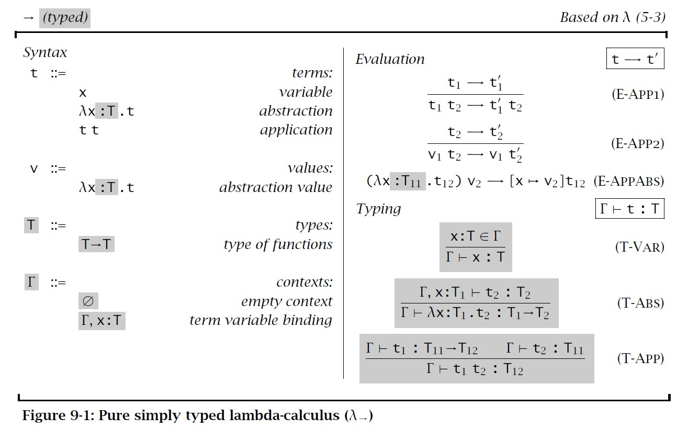

通常，简单类型的lambda表达式会用`λ→`表示。

# Properties of Typing

这一段主要是为了添加一些工具去证明类型安全。

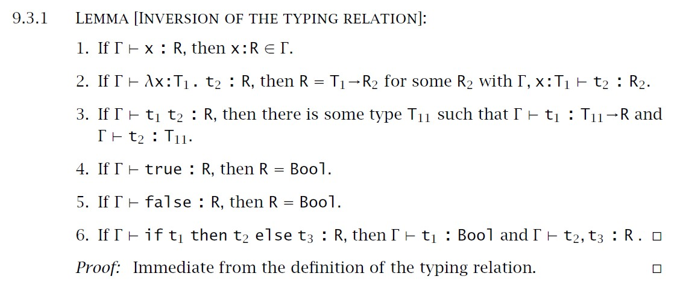

这个主要是为了证明，如果当前的项是良好类型化的，那么他的子项也必须是良好类型化的。

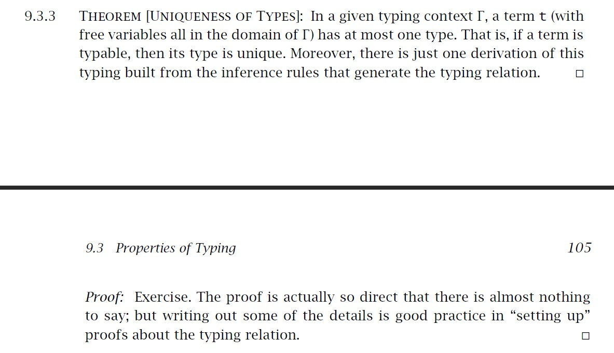

这规则表述了类型的唯一性，也就是在上下文中，所有项对应的任何类型都是唯一的，类型关系的规则也是唯一的。

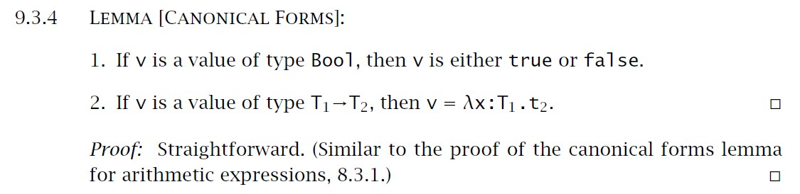

这里也相当直白，规范形式引理，规定一个值如果存在类型，那么它的结构必须是该类型对应的形式。Bool类型对应的绝对不会是函数，反之亦然。这个引理保证了类型的安全性。

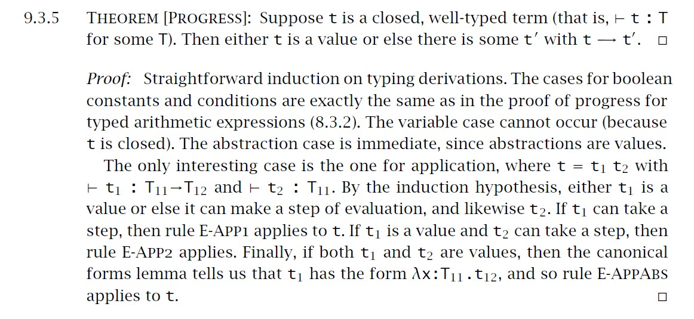

9.3.5，Progress 定理，如果项`t`是闭合的（closed），也就是不存在free variables，同时也是良类型定义的，那么`t`只能是一个`值`或者是某个项`t'`并存在对应关系`t → t'`。

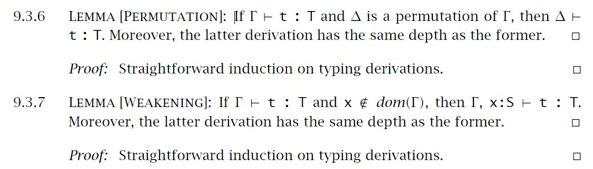

9.3.6表明了上下文类型的顺序并不会改变类型推断结论。

9.3.7则说明了就算存在无关变量也不好改变类型推断结论。

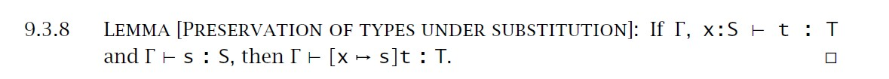

引理9.3.8，类型在替换下保持不变，上面句子说人话就是：在类型环境 Γ 下，如果 s 的类型是 S，且 t 在一个包含变量 x 的环境中拥有类型 T，那么把 s 替换到 t 的所有 x 位置之后，仍然能得到一个类型为 T 的项。

在实际编程中的作用就是保证在给函数传入参数以后，函数类型结果并不会有改变。

举个例子，假设存在一个函数：
```text
t = λy:Int. x + y
```
并且我们知道
```text
x: Int ⊢ t : Int → Int
Γ ⊢ 3 : Int
```
那么把`x`替换成`3`，也就是`[x ↦ 3]t`，结果会变成
```text 
λy:Int. 3 + y
```
结果仍然保持着类型`Int → Int`，也就是这个引理在说的事情，也就是保证了代入行为的类型安全性。

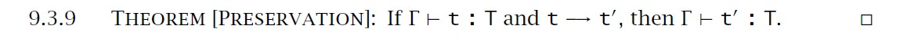

这条引理说人话就是：如果一个程序项 t 在某个环境下拥有类型 T，而且它能执行（变成 t′），那执行后的结果 t′ 的类型也仍然是 T。

也就是说类型不变，这里可能脑子一时转不过弯来，这里单纯的对`t`做计算，`t`计算的结果就是`t'`，类型`T`是没变过的。举个例子，假设`t=1+2`，那么计算的结果就是`t' = t = 1+1 = 2`，由始至终类型都没有变过，都是数字。

`t → t'` 和 `T → T'`是不一样的，`t → t'`表示的是程序项的执行（reduction），举个例子就是做某个计算，计算前计算后类型都是一样的，但是值不一样而已。而`T → T'`表示的是类型之间的函数关系，可能从某个类型的值变成另一个类型的值。

# The Curry-Howard Correspondence

`→` 类型构造符带来了两条类型规则，引入与消除规则：
1. Introduction rule (T-ABS) 说明如果某表达式在某变量假设下具有某类型，那么 λ 抽象就有函数类型。
2. Elimination rule (T-APP) 说明如何使用函数类型的值来应用参数。

```text
如果 Γ, x:T ⊢ t : T′  
则 Γ ⊢ λx:T. t : T → T′    （T-ABS）

如果 Γ ⊢ t1 : T → T′ 且 Γ ⊢ t2 : T  
则 Γ ⊢ t1 t2 : T′          （T-APP）
```

The Curry-Howard Correspondence 其实就是指类型论和逻辑的联系。实际所主张的：
- 逻辑中的命题 ≈ 编程语言中的类型
- 逻辑中的证明 ≈ 编程语言中的程序

一个命题 P ⇒ Q 的证明可以理解为一个“给出 P 的证明就能生成 Q 的证明”的过程，这就是函数应用的本质。这类命题的证明像函数：它“接受”一个输入（P 的证明）并“返回”一个输出（Q 的证明）。

这里还有个备注关于经典逻辑和构造性逻辑的差异：在构造性逻辑里，并不接受 Q ∨ ¬Q 作为总是成立的定理，除非你能具体构造出一个证明。

| 逻辑                           | 编程语言                              |
|--------------------------------|----------------------------------------|
| 命题（propositions）           | 类型（types）                          |
| 命题 P ⊃ Q                     | 类型 P → Q                             |
| 命题 P ∧ Q                     | 类型 P × Q（详见 §11.6）              |
| 对命题 P 的证明                | 类型为 P 的项 τ                        |
| 命题 P 可被证明                | 类型 P 是“被占用”的（inhabited）     |

基于这个观点，一个简单类型的lambda项就是一个逻辑命题。

- 在 **简单类型 λ 演算** 中：
  - 项 `τ` 具有类型 `A` ⇒ 证明了命题 `A`
  - 计算过程 ≈ 通过“剪除”（cut elimination）简化证明过程

- 此对应关系又称：
  - **命题即类型**（Propositions-as-Types analogy）

- 可扩展到更复杂的系统：
  | 类型系统         | 对应逻辑                 |
  |------------------|--------------------------|
  | System F         | 二阶构造性逻辑（Second-order constructive logic） |
  | System Fω        | 高阶逻辑（Higher-order logic）       |

- 应用场景：
  - 利用该对应关系在不同领域间 **转移理论发展**
  - 如 **线性类型系统** & **模态逻辑** 用于：
    - 局部计算（Partial evaluation）
    - 运行时代码生成（Run-time code generation）

Cut Elimination 定理：如果一个命题可以通过使用 Cut Rule 来证明，那么也一定存在一个不使用 Cut Rule 的证明。

Cut Rule 允许你使用一个中间命题 A 来连接两个证明：
```text
Γ ⊢ A      Δ, A ⊢ B
---------------------
Γ, Δ ⊢ B
```

# Erasure and Typability

这里说明了在类型计算的时候，实际上是不在evaluation的时候计算的，这也就是为什么静态类型系统都只存在于编译期而不是运行期。在计算完类型以后，都会把类型擦除掉。

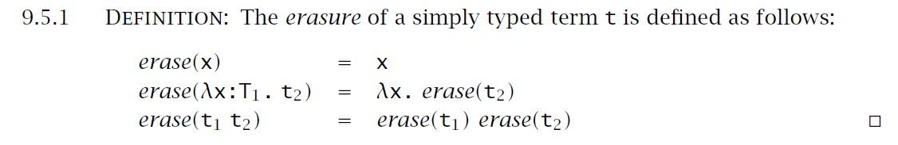

上图讲述了如何做类型擦除。

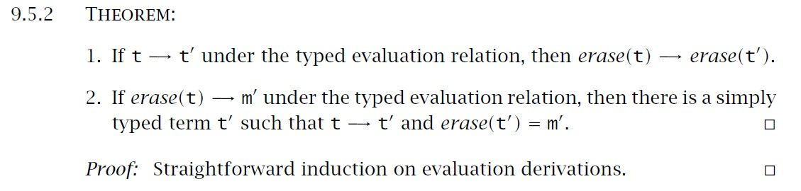

上图说明，无论你是先求值再擦除，还是先擦除再求值，结果一致。这是语言语义的一种“兼容性保证”。

基于9.5.2，可能会存在一个问题，如果给出任意一个没有类型的lambda项`m`，我们是否可以给`m`找到对应的简单类型项`t`？

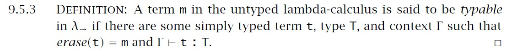

上图是在说：
如果存在某个简单类型项 `t`、类型 `T` 和上下文 `Γ`，满足：
- `erase(t) = m`
- `Γ ⊢ t : T`

那么我们说 `m` 是 typable（可类型化的）

Typability 指的是：一个无类型的 λ 项（term）是否可以被解释成一个有类型的 λ 项。也就是说——你拿着一个纯 λ 表达式 m，能不能为它“加上类型标签”让它在一个类型系统中合法存在。

简单点来说就是一个变量想要被类型化就必须得存在对应的类型。

举个例子：
#### ✅ 示例一：`λx. x` 是 typable

```haskell
-- 无类型 λ 项
m = λx. x

-- 类型化项（添加类型注解）
t = λx:int. x

-- 类型推导
Γ ⊢ λx:int. x : int → int

-- 类型擦除后恢复原始项
erase(t) = m

-- 结论
✔️ m 是 typable，因为它可从类型化项 t 还原，并且 t 在环境 Γ 下合法
```

#### ❌ 示例二：不可类型化的 Ω 项 (λx. x x) (λx. x x)

```haskell
-- 无类型 λ 项
m = (λx. x x) (λx. x x)

-- 尝试为 x 赋类型：x : T → T
-- 则 x x : T → T → T 导致类型循环，违背简单类型系统的限制

-- 结论
❌ m 是 NOT typable，因为无法赋予一致类型
```

# Curry-Style vs. Church-Style

在简单类型 λ 演算中，存在两种主流语义设计方式：**Curry 风格**与**Church 风格**。它们代表着不同的类型系统构建思路，影响语言表达力与类型安全机制。

---

### 🔍 基本区别比较

| 风格     | 构建顺序                        | 类型处理方式             | 常见应用                        |
|----------|----------------------------------|--------------------------|---------------------------------|
| **Curry**  | 先定义所有 λ 项，再赋予语义     | 类型是对项的外部赋值       | 类型推导、无类型分析             |
| **Church** | 只定义类型正确的 λ 项，再给语义 | 类型是项定义的一部分       | 显式类型语言（如 OCaml, Haskell）|

---

### 💡 Curry 风格解读

- **策略**：先构造所有可能的 λ 项，无论是否具有类型 → 后续再尝试为它们推导语义与类型。
- **特征**：语言中允许存在“未类型化”项，语义赋予不依赖于类型正确性。
- **优点**：更灵活、适用于类型推导与泛型分析。

---

### 💡 Church 风格解读

- **策略**：语言中只允许构造“类型合法”的 λ 项，然后再定义其语义。
- **特征**：类型作为表达式的一部分，语言构造过程即蕴含类型检查。
- **优点**：保证类型安全、适合编译型强类型语言。

---

### 🧩 学术与实务意义

这两种风格的差异影响：

- 类型系统的设计哲学（如是否允许不合法项进入系统）
- 编译器如何处理类型（推导 vs 检查）
- 表达式是否可以单独讨论语义而不依赖类型


